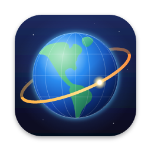
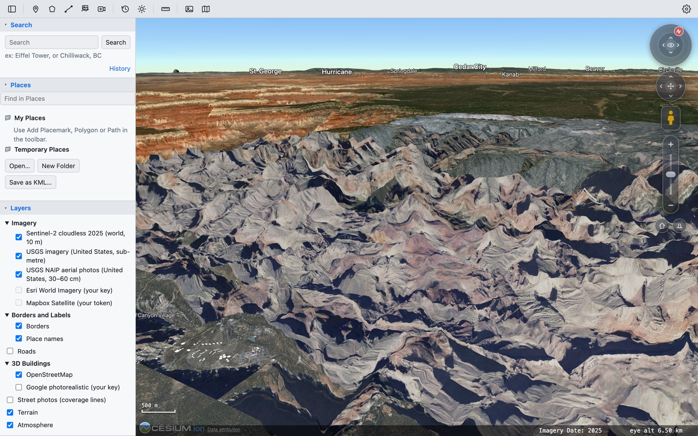
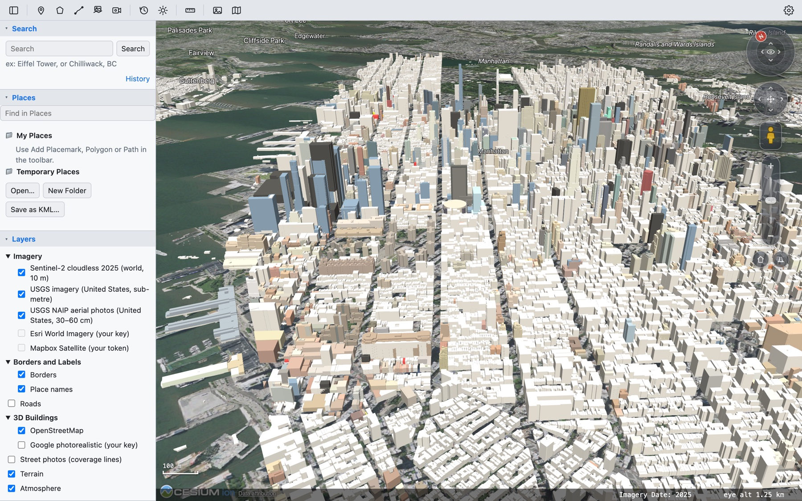
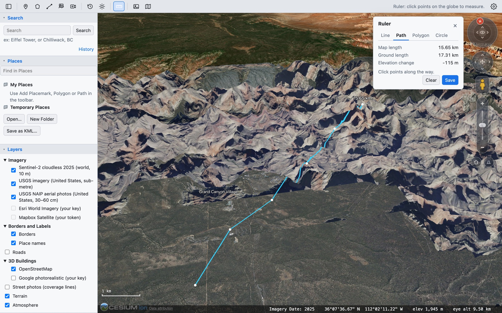
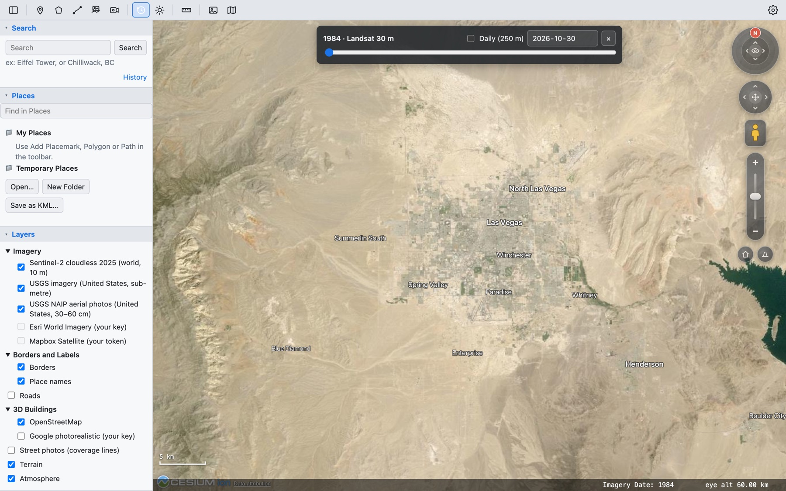
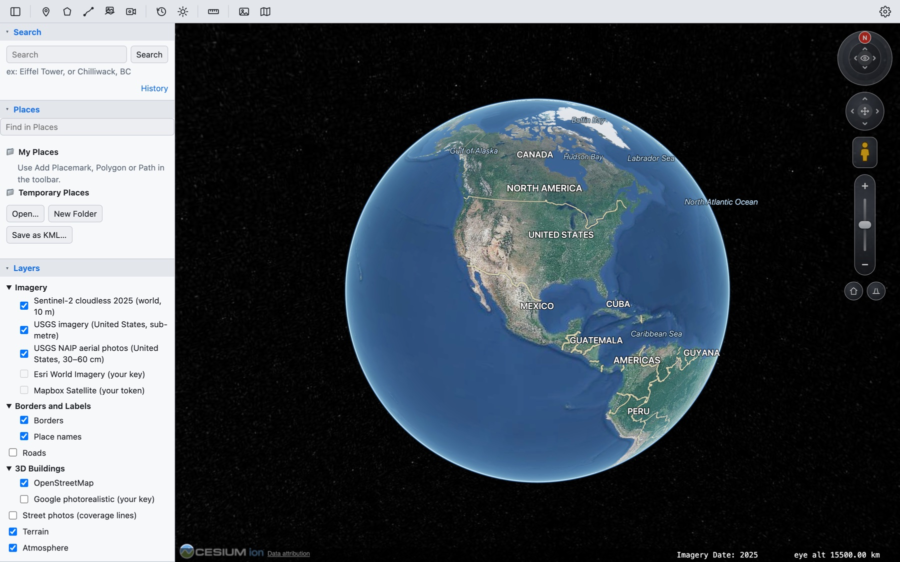

<div align="center">



# OpenOrbit

**A free, open-source desktop globe in the spirit of Google Earth Pro.**<br>
3D terrain, satellite and aerial imagery, historical imagery, measuring tools and your own KML,
GPS and GIS files, on macOS, Windows and Linux. No account and no project servers: it reads
public map data directly.

[](https://github.com/wjacobs20301/openorbit/releases/latest)
[](https://github.com/wjacobs20301/openorbit/releases/latest)
[](LICENSE)

[**Download**](https://github.com/wjacobs20301/openorbit/releases/latest) ·
[Features](#features) ·
[Controls](#controls) ·
[Data sources](#data-sources) ·
[Building from source](#building-from-source)



</div>

## Why OpenOrbit?

Google Earth Pro is being retired. OpenOrbit keeps the parts people rely on (the familiar
layout, KML, placemarks and paths, the ruler, historical imagery, saving images and tours)
in an open-source app built on open data. It looks and works the way Google Earth Pro users
expect, so there's nothing new to learn.

## Download

Get the installer for your system from the [latest release](https://github.com/wjacobs20301/openorbit/releases/latest):

| System | File |
|---|---|
| macOS, Apple Silicon (M1 and later) | `OpenOrbit_x.y.z_aarch64.dmg` |
| macOS, Intel | `OpenOrbit_x.y.z_x64.dmg` |
| Windows 10 and 11 | `OpenOrbit_x.y.z_x64-setup.exe` (or the `.msi`) |
| Linux | `.AppImage` (any distribution), `.deb` (Debian, Ubuntu) or `.rpm` (Fedora, openSUSE) |

The installers aren't code-signed yet:
- **macOS:** if it says the app can't be opened, right-click OpenOrbit in Applications and choose **Open**.
- **Windows:** if SmartScreen appears, choose **More info › Run anyway**.

OpenOrbit tells you when a new version is out.

## Features

### Explore the whole planet in 3D



- **Imagery everywhere:** Sentinel-2 cloudless (10 m) worldwide. In the US, USGS imagery,
  plus USDA NAIP aerial photos down to 30 cm when you zoom right in. Optionally, Esri or
  Mapbox imagery with your own free key.
- **Terrain** you can tilt and fly through, and **3D buildings** for cities worldwide from
  OpenStreetMap. Optionally, Google's photorealistic 3D Tiles with your own key.
- **Search** for any place, with history, plus place names, borders and roads.
- **Navigation like Google Earth's:** look ring, move joystick, zoom slider, keyboard
  shortcuts, and a street view person you drag onto the map.
- **Street-level photos** from Panoramax and Mapillary, with a one-click jump to Google
  Street View.

### Measure, draw and keep your places



- **Ruler** with Line, Path, Polygon and Circle tabs. It shows map length, length over the
  terrain, heading, area and elevation change, and **Save** keeps a measurement.
- **Placemarks, paths and polygons** with icons, colours, descriptions, altitude settings
  and saved camera views, organised in folders with drag and drop.
- **Elevation profiles** for any path, **image overlays** (drape a site plan or old map on
  the terrain), and **tours** you can record, play back or save as video.
- Units in metres or feet, and coordinates as degrees-minutes-seconds, decimal degrees or UTM.

### Look back in time



- **Historical imagery:** Landsat back to 1984, yearly Sentinel-2 from 2016, and a daily
  image for any date since 2000. Above, Las Vegas in 1984.
- **Sunlight** across the landscape for any time of day.
- A **time slider** for KML with dates, such as GPS tracks or earthquake feeds.

### Bring your own data



- **Open** KML and KMZ, GeoJSON, GPX, CSV (coordinates or street addresses) and shapefiles,
  or just drag files onto the window. Pictures become image overlays.
- **Network links** for live KML feeds, refreshed on a timer.
- **Save** My Places as KML or KMZ, **save images** up to 8K with a title, legend, compass
  and scale, and print.
- **Works offline** for places you've already visited, and can save a whole view for later.

<details>
<summary><b>Full feature list</b></summary>

- 3D globe with terrain (CesiumJS), drawn at full Retina sharpness
- Imagery: Sentinel-2 cloudless (world, 10 m), USGS imagery (US), and USGS NAIP aerial
  photos (US, 30–60 cm) for close-up views
- Optional sharp worldwide imagery with your own key: Esri World Imagery (ArcGIS Location
  Platform) or Mapbox Satellite; these are never written to the disk cache
- Time slider: Landsat back to 1984 (30 m), yearly Sentinel-2 from 2016, and a daily MODIS
  image for any date since February 2000 (250 m)
- Place search (Photon / OpenStreetMap) with history
- Place names, country/state borders and roads from OpenStreetMap vector tiles
- 3D buildings worldwide from OpenStreetMap (heights and colours from the map data)
- Optional Google Photorealistic 3D Tiles with your own Google Maps API key; search switches
  to Google's geocoder while they're on, as Google's terms require
- Placemarks, paths and polygons with colours, icons, live length/area, saved between
  sessions and exported as styled KML
- Edit places like Google Earth's Properties window: name, description, colour, line width,
  fill opacity, folder, icon, altitude (clamped, relative, absolute, extend to ground) and
  "Snapshot current view"; drag placemarks and corner handles to reshape, drag a midpoint to
  add a corner, double-click a corner to remove it; Cancel undoes
- Folders in My Places with drag and drop, a Find in Places filter, and Undo after deleting
- Import KML/KMZ, GeoJSON, GPX, CSV (latitude/longitude or address columns) and shapefiles
  (zipped, or .shp with its .dbf/.prj), with no vertex limit; flat KML is draped on the
  terrain, the file's folders show as a tree with checkboxes, and **Keep** saves a file in
  My Places
- Click any feature for a details balloon (including KML ExtendedData/SchemaData)
- Time slider for KML with dates (TimeStamp/TimeSpan): drag, play, or show all
- Network links (Add › Network Link): KML/KMZ from the web, refreshed on a timer
- Ruler with Line, Path, Polygon and Circle tabs; Save keeps the measurement in My Places
- Elevation profile for paths and lines (distance, elevation range, climb, steepest grade)
- Image overlays: drape a picture on the terrain, then move, stretch, rotate and set its
  opacity; saved in My Places and exported as KMZ
- Tours: record one, or fly along any path; play back with a scrubber, speed and loop;
  save as an MP4/WebM video
- Save Image with title, description, legend, compass and scale, up to 8K; Copy Image; Print
- Latitude/longitude grid (View › Grid) and an overview map (View › Overview Map)
- Right-click the globe: What's here?, add a placemark, street view, measure, centre the
  view, copy coordinates
- Units (metres or feet) and coordinates as degrees-minutes-seconds, decimal minutes,
  decimal degrees or UTM
- Street-level photos: Panoramax (no key), Mapillary (optional token), and "Open in Google
  Street View"
- Opens where you left off, or at a start location you set; layers and View options are
  remembered
- Disk tile cache on desktop, so places you've visited load instantly and work offline;
  "Save this view for offline" prefetches the visible area (capped at 4,000 tiles)
- Tells you when a new version is out (daily check, or OpenOrbit › Check for Updates)

</details>

## Controls

The layout follows Google Earth Pro: toolbar across the top, sidebar with Search, Places and
Layers on the left, navigation controls at the top right, and a status bar with the imagery
date, pointer position, elevation and eye altitude.

| Action | Mouse / trackpad | Keyboard |
|---|---|---|
| Move | Drag | Arrow keys |
| Tilt and turn | Shift+drag (or middle-drag, Ctrl+drag) | Shift+arrows |
| Look around in place | Option/Alt+drag | |
| Zoom | Scroll / pinch, zoom slider | + and − |
| Reset north / tilt / both | Click N on the ring | N / U / R |
| Add placemark / polygon / path | Toolbar | ⇧⌘P / ⇧⌘G / ⇧⌘T |
| Sidebar · Search · Save image | | ⌥⌘B · ⌘F · ⌥⌘S |
| Grid · Overview map | | ⌘L · ⌥⌘M |

**Street view:** drag the person from the navigation controls onto a blue line (it snaps to
the nearest photo). Then drag or use ←/→ to look around, click the road to move there, use
↑/↓ to step along the route, and press F to expand the viewer.

On Windows and Linux, use Ctrl in place of ⌘.

## Data sources

OpenOrbit runs no servers of its own; it reads these public services directly. All
endpoints live in [`src/sources.ts`](src/sources.ts).

| Data | Source | Licence |
|---|---|---|
| World imagery | EOX Sentinel-2 cloudless 2025 (2016–2024 in the time slider) | CC BY-NC-SA 4.0 (non-commercial); 2016 is CC BY 4.0 |
| Historical imagery | NASA GIBS: Landsat WELD annual, MODIS Terra daily | Open, attribution requested |
| US imagery | USGS The National Map, USDA NAIP | Public domain |
| Terrain | AWS Terrain Tiles | Open data, attribution required |
| Search | Photon (komoot), OpenStreetMap | ODbL, fair use |
| Labels, borders, roads, buildings | OpenFreeMap vector tiles (OpenMapTiles schema) | ODbL, free with attribution |
| Sharp imagery (optional) | Esri World Imagery, Mapbox Satellite, user's own key | Provider terms; free tiers, attribution required |
| Photorealistic 3D (optional) | Google Map Tiles API + Geocoding API, user's own key | Google Maps Platform terms; billed to the user |
| Street photos | Panoramax, Mapillary | CC BY-SA 4.0 |

These services are free; please keep the tile cache on and don't add bulk "download a
region" features for providers that forbid it.

## Building from source

Requires Node 20+ and Rust (via [rustup](https://rustup.rs)). On Linux, also install the
[Tauri system packages](https://v2.tauri.app/start/prerequisites/#linux).

```bash
npm install
npm run tauri dev     # desktop app
npm run dev           # browser only, at http://localhost:1420
npm run tauri build   # installers for the current system
```

<details>
<summary><b>Releasing</b></summary>

Bump `version` in `package.json`, `src-tauri/Cargo.toml` and `src-tauri/tauri.conf.json`,
then push a version tag:

```bash
git tag v0.2.0
git push origin v0.2.0
```

GitHub Actions ([`release.yml`](.github/workflows/release.yml)) builds the installers for
every platform and attaches them to a draft release. Review the draft, then publish it;
people on older versions are told about it the next time they open the app.

| Platform | Files |
|---|---|
| macOS (Apple Silicon and Intel) | `.dmg`, `.app.tar.gz` |
| Windows | `.msi`, `-setup.exe` |
| Linux | `.AppImage`, `.deb`, `.rpm` |

Builds are unsigned. To sign them, add an Apple Developer ID and/or a Windows certificate as
repository secrets; see Tauri's [macOS](https://v2.tauri.app/distribute/sign/macos/) and
[Windows](https://v2.tauri.app/distribute/sign/windows/) signing guides.

</details>

<details>
<summary><b>Project layout</b></summary>

- `src/`: web front end (TypeScript, CesiumJS)
  - `globe.ts` viewer and imagery layers, `terrain.ts` terrain from Terrarium tiles
  - `search.ts`, `places.ts` (saved places + KML export), `editor.ts` (Properties window),
    `draw.ts` (paths/polygons), `measure.ts` (ruler), `geometry.ts` and `units.ts`
  - `vectortiles.ts` tile loading, `overlay.ts` borders/roads, `labels.ts` place names
  - `buildings.ts` OpenStreetMap 3D buildings, `google3d.ts` Google 3D Tiles
  - `history.ts` historical imagery, `timebar.ts` KML time slider, `importer.ts` file
    import, `networklinks.ts`, `imageoverlay.ts`, `tour.ts`, `saveimage.ts`
  - `platform.ts` desktop/browser helpers, `sources.ts` data endpoints, `updates.ts`
- `src-tauri/`: desktop shell (Rust); `tile_cache.rs` serves `tiles://` requests from disk

</details>

## Licence

[MIT](LICENSE). Map data remains under its providers' licences; credits are shown on the globe.
